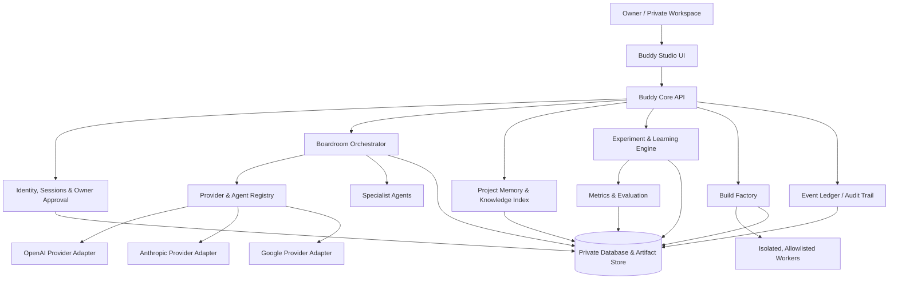

# Buddy Innovation Environment — Application Architecture v1

**Status:** Architecture specification committed; implementation is not yet complete.  
**Owner model:** One private owner (single-user first).  
**Primary repository:** `KrugercoinHF/buddy-computer-forge`  
**Date:** 2026-11-13  
**Decision authority:** The owner approves priorities, external connections, spending, publication, deployment, and risky execution.

## 1. Product intent

Build a private environment in which one owner can turn ideas into tested outcomes by coordinating multiple AI providers and specialist agents. The system is not merely a chat interface or a code generator. It is an innovation operating environment that preserves context, runs bounded experiments, builds projects, measures validated learning, and records why decisions were made.

The operating cycle is:

**Capture → Frame → Experiment → Build → Measure → Learn → Decide → Improve**

The long-term vision is to support multiple projects and AI providers. The first release deliberately limits scope to one owner, one workspace, a small number of explicitly configured providers, and safe experiments.

## 2. Product principles

1. **Owner authority:** The owner is the final decision-maker. AI agents recommend and execute only within explicitly granted permissions.
2. **Evidence over claims:** Distinguish proposed, simulated, tested, committed, deployed, and observed states.
3. **Validated learning:** Count learning only when an assumption is tested against evidence and a decision is recorded.
4. **Small batches:** Prefer short experiments and reviewable changes over large speculative builds.
5. **Provider honesty:** A provider is “connected” only after credentials are configured securely and a live health/test call succeeds.
6. **Private by default:** Single-user data stays private; no public sharing or training use is implied.
7. **Reversible work:** Version plans, retain run records, checkpoint changes, and support rollback.
8. **Security boundaries:** No arbitrary shell execution by an AI agent. Use allowlisted tasks, isolated workers, resource limits, and approvals.
9. **Attribution and provenance:** Record who originated an idea, when it was captured, what changed, which agents contributed, and which source commits/artifacts resulted. Provenance records document contribution; they do not independently establish legal ownership.

## 3. High-level architecture

### Component responsibilities

- **Buddy Studio UI:** Dashboard, project map, boardroom transcript, experiment cards, approvals, learning charts, artifact viewer.
- **Buddy Core API:** Authenticated application boundary; validates all requests and permissions.
- **Boardroom Orchestrator:** Creates a meeting, gives each selected agent the same bounded brief and context, collects independent responses, requests critique, and produces a chairperson synthesis.
- **Provider Adapters:** One adapter per real model provider. Each reports configured, reachable, degraded, or disconnected state. Keys remain server-side.
- **Specialist Agents:** Researcher, architect, engineer, tester, security reviewer, product/customer analyst, and recorder. Roles are prompts and permission profiles, not independent authorities.
- **Project Memory:** Stores owner-approved facts, decisions, artifacts, and project-specific summaries with source references and timestamps.
- **Experiment Engine:** Defines hypotheses, success/failure criteria, sample limits, observations, and decisions.
- **Build Factory:** Tracks repositories, source commits, jobs, tests, artifacts, and provenance. It must not claim execution merely because a run record exists.
- **Worker Runtime:** Executes only approved allowlisted operations in isolated workspaces with CPU, memory, time, network, and filesystem limits.
- **Metrics & Evaluation:** Computes activity, delivery, quality, and validated-learning indicators.
- **Event Ledger:** Append-only record of important actions, approvals, model calls, experiment results, and state transitions.

## 4. Main application areas

### A. Owner home
- Current mission and top priorities
- Active projects and blocked items
- Latest boardroom decisions
- Experiment status
- Build/test status
- Learning trend for the selected period
- Pending approvals and risk alerts

### B. AI Boardroom
A meeting has a chairperson, agenda, participants, shared brief, time/turn budget, and output contract.

Meeting flow:
1. Owner creates a question or decision brief.
2. Chairperson extracts the decision to be made and constraints.
3. Selected providers independently analyse the same brief.
4. Agents identify agreement, disagreement, assumptions, evidence gaps, and risks.
5. A critic/reviewer challenges the draft.
6. Chairperson synthesizes options and recommendation with citations to internal evidence.
7. Owner accepts, edits, rejects, or requests another round.
8. Accepted decisions become versioned project records.

Do not simulate a provider response and label it as a live provider response. A local mock provider may be used in tests, visibly marked **SIMULATED**.

### C. Project and idea workspace
Each project stores:
- Name, purpose, owner, status, repository, stack, target users
- Problem statement and value hypothesis
- Customer/user assumptions
- Milestones and acceptance criteria
- Risks, dependencies, budget limits, and approvals
- Linked meetings, experiments, commits, tests, and artifacts

### D. Experiment lab
Every experiment includes:
- Hypothesis (for example: “A first-time user can complete task X without assistance”)
- Assumption category and risk
- Test method and target sample
- Success and failure thresholds
- Timebox and resource ceiling
- Observations and evidence links
- Result: supported, rejected, inconclusive, or not run
- Decision: persevere, pivot, or run another experiment

### E. Build Factory
- Register repositories and project metadata
- Record source commit before a run
- Queue an approved build/test job
- Execute in an isolated worker only after worker security gates pass
- Capture logs, test reports, artifact hashes, duration, exit status, and environment
- Require explicit approval for deployment, external publication, destructive changes, or spend

The current repository already has a preliminary project/run ledger and owner-gated routes. That ledger records build intent and status; it is not yet a secure autonomous execution system.

### F. Memory and provenance
- Owner-controlled project memory
- Source-linked notes and decisions
- Version history and timestamps
- Idea-origin and contribution log
- Export and deletion controls
- Never silently overwrite an earlier decision; supersede it with a new version

## 5. Suggested data model

Core tables/entities:

| Entity | Purpose | Key fields |
|---|---|---|
| users | Single owner initially | id, display_name, created_at |
| projects | Project registry | id, name, purpose, status, repository |
| ideas | Captured ideas | id, project_id, title, body, originator, captured_at |
| meetings | Boardroom sessions | id, project_id, agenda, status, created_at |
| meeting_turns | Provider/agent contributions | id, meeting_id, agent_id, role, content, provider_status |
| providers | Real provider configuration metadata | id, provider, enabled, health, secret_reference |
| agents | Specialist roles | id, name, role, permission_profile |
| decisions | Owner decisions | id, project_id, meeting_id, decision, rationale, decided_at |
| assumptions | Testable beliefs | id, project_id, statement, risk, status |
| experiments | Hypothesis tests | id, assumption_id, method, thresholds, status |
| observations | Experiment evidence | id, experiment_id, value, evidence_uri, observed_at |
| learning_events | Validated learning records | id, experiment_id, learning_type, confidence, decision_id |
| build_runs | Build/test history | id, project_id, commit, environment, status, report_uri |
| approvals | Permission grants | id, action, scope, requested_by, approved_by, expires_at |
| artifacts | Files and outputs | id, project_id, uri, sha256, media_type |
| audit_events | Security and provenance log | id, actor, event_type, object_id, timestamp, details |

All important entities need stable IDs, UTC timestamps, ownership, and project association. Sensitive credentials are stored in a secret manager or local OS keychain; only a secret reference is stored in the database.

## 6. Learning measurement: one-user baseline

Do not measure learning by message count, token count, lines of code, or number of AI replies. Those measure activity, not learning.

### Primary unit: Validated Learning Unit (VLU)

One VLU is awarded only when all five conditions are met:
1. A specific, falsifiable assumption existed before the test.
2. A test or observation was actually performed.
3. Evidence was recorded and linked.
4. The result was classified (supported, rejected, or inconclusive).
5. A decision or next action was recorded.

An idea, discussion, generated answer, unrun test, or unverified simulation earns **zero VLU**.

### Metrics

- **VLU/week:** Number of validated learning units completed in the week.
- **Learning velocity:** VLU divided by active project hours. Unit: VLU/hour.
- **Decision latency:** Median elapsed time from experiment completion to owner decision.
- **Assumption resolution rate:** Resolved assumptions / assumptions tested.
- **Experiment completion rate:** Completed experiments / started experiments.
- **Rework rate:** Work invalidated by a changed or disproved assumption / total work items.
- **Delivery reliability:** Passing verified acceptance checks / checks attempted.
- **Evidence coverage:** Decisions with linked evidence / decisions made.
- **Owner effort:** Active owner minutes per completed VLU.
- **AI contribution usefulness:** Owner-rated useful agent contributions / agent contributions reviewed. Keep ratings separate by provider and task type; do not treat model self-ratings as evidence.

### Rate per second

A per-second rate is mathematically possible but too noisy to be a useful product KPI. Store event timestamps at millisecond precision if needed, but report learning at daily and weekly intervals. If displayed, define:
- instantaneous event rate = validated learning events / elapsed seconds in the selected window;
- weekly learning velocity = VLU / active owner hours in the week.

Never label raw messages or model tokens as “learning per second.”

### Single-user baseline

During the first 7 days, collect a baseline without optimizing for volume:
- owner active time;
- ideas captured;
- assumptions made testable;
- experiments started/completed;
- VLUs earned;
- decisions made with evidence;
- builds/tests attempted and passed;
- defects/rework;
- owner usefulness rating for each agent contribution.

Show counts and rates together. With one user and small samples, label trends **early signal**, not statistically proven improvement. Do not compare providers unless they receive comparable tasks and evaluation criteria.

## 7. Illustrative seven-day simulation (not observed results)

This is a sample scenario for testing the dashboard and metric formulas. It is synthetic data, not a claim that the application has run for a week or that the owner achieved these results.

| Day | Activity | Experiments completed | VLUs | Owner decision |
|---|---|---:|---:|---|
| 1 | Capture mission and list risky assumptions | 0 | 0 | Select first assumption |
| 2 | Test whether boardroom outputs are actionable | 1 | 1 | Keep structured decision format |
| 3 | Compare two meeting templates on the same task | 2 | 1 | Retain template B; investigate mixed result |
| 4 | Test project memory retrieval against known facts | 1 | 1 | Require source links for recalled facts |
| 5 | Test build record completeness with a controlled sample repo | 2 | 2 | Add missing provenance fields |
| 6 | Test approval flow and denied-action handling | 2 | 1 | Block unapproved execution |
| 7 | Review evidence and plan next cycle | 0 | 0 | Prioritize provider integration and worker isolation |

**Illustrative totals:** 8 experiments completed, 6 VLUs, 2 unresolved/inconclusive outcomes, 1 owner review. These values exist only to demonstrate the calculation.

If the owner spent 6 active hours during the week, illustrative learning velocity would be **6 VLU / 6 hours = 1.0 VLU per active hour**. This is not a forecast or performance promise.

## 8. Seven-day real pilot plan

- **Day 1 — Baseline:** Confirm mission, capture current project state, define 3–5 testable assumptions.
- **Day 2 — Boardroom skeleton:** Create meeting, participant, turn, and synthesis records using visibly simulated adapters.
- **Day 3 — Provider boundary:** Implement one real provider adapter only after secure server-side secret setup; verify with a live health/test call.
- **Day 4 — Experiment lab:** Add hypothesis, test, evidence, result, and decision workflow.
- **Day 5 — Learning dashboard:** Calculate VLU, learning velocity, decision latency, evidence coverage, and owner effort.
- **Day 6 — Build Factory integration:** Link a registered project to a controlled test run; do not enable unrestricted shell or deployment.
- **Day 7 — Review:** Run acceptance tests, inspect audit history, compare baseline to observed results, and decide whether to persevere or pivot.

A “one-week simulation” can be run immediately with synthetic fixtures. A real seven-day learning curve requires seven days of actual timestamped usage. The system must display these as two different modes.

## 9. API outline

Initial authenticated API groups:

- `/api/owner/*` — owner profile, session, settings
- `/api/projects/*` — project and idea registry
- `/api/boardroom/meetings/*` — create, run, review, and close meetings
- `/api/providers/*` — provider configuration status and health checks (never return secrets)
- `/api/agents/*` — specialist definitions and permission profiles
- `/api/experiments/*` — hypotheses, runs, observations, results
- `/api/learning/*` — VLU ledger and dashboard aggregates
- `/api/factory/*` — existing project/build-run ledger; execution remains gated
- `/api/approvals/*` — request, approve, deny, expire, and audit permissions
- `/api/artifacts/*` — safe metadata, upload/download authorization
- `/api/audit/*` — owner-only audit history

## 10. Security and privacy requirements

- Bind local service to localhost by default.
- Require strong owner authentication; remove unsafe default credentials for non-test operation.
- Store API keys outside source control and outside browser code.
- Encrypt sensitive data at rest where practical; restrict file permissions.
- Apply CSRF protection for cookie sessions, rate limits, input validation, and request size limits.
- Use explicit provider allowlists and model/time/cost budgets.
- Worker jobs run in isolated containers or OS sandboxes with no host home-directory access.
- Default-deny network access for workers; allow only required destinations.
- Enforce approval on the server, not only in the UI.
- Audit all permission requests, approvals, executions, provider calls, exports, and deletions.
- Add retention/export/delete controls for private conversation and project data.
- Threat-model prompt injection from web pages, repositories, documents, and tool output; treat retrieved content as untrusted data.
- No public launch until authentication, authorization, isolation, backup/restore, and security tests pass.

## 11. Acceptance criteria

The first usable release is complete only when:
1. The owner can create a private project and capture an idea with timestamp/provenance.
2. A boardroom meeting can be created, and simulated providers are visibly labeled as simulated.
3. At least one real provider can be configured securely and pass a live test call.
4. The meeting stores each contribution and a traceable synthesis.
5. An assumption can be converted into an experiment with criteria and evidence.
6. A completed experiment can create a VLU only when all VLU rules are satisfied.
7. The dashboard shows weekly metrics and clearly separates synthetic from observed data.
8. Build/test runs capture commit, environment, logs, exit state, and artifacts.
9. Unapproved sensitive actions are denied by server-side checks and recorded in the audit log.
10. Tests cover authentication, authorization, provider failure, data isolation, metric calculations, approval denial, and audit events.

## 12. Current verified implementation boundary

As of this architecture record:
- Buddy Computer Forge is an existing FastAPI/SQLite control-plane project.
- The repository has an owner-gated Build Factory project/run ledger.
- The current Build Factory module explicitly records intent and outcomes; it does not itself execute shell commands, start workers, or deploy software.
- The existing project has a test suite, but this architecture document has not itself been executed as application code.
- The full AI Boardroom, provider adapters, experiment engine, VLU ledger, learning dashboard, and seven-day real pilot are **specified, not yet implemented**.

## 13. Immediate implementation sequence

1. Add schema migrations for projects, ideas, meetings, provider registry, turns, decisions, experiments, observations, learning events, approvals, artifacts, and audit.
2. Build a minimal owner-only UI shell with project navigation and a learning dashboard.
3. Implement the boardroom meeting lifecycle with simulated adapters and explicit simulation labels.
4. Add one secure live provider adapter and verify it end-to-end.
5. Implement experiment tracking and VLU rules with unit tests.
6. Connect Build Factory run records to project and experiment records.
7. Add isolated worker execution only after threat model, server-side approval enforcement, and isolation tests pass.
8. Run the seven-day pilot; publish observed results separately from the synthetic simulation.

**North-star outcome:** The owner can see what was attempted, what actually worked, what was learned, what changed because of that learning, how much owner effort it took, and what should happen next.
